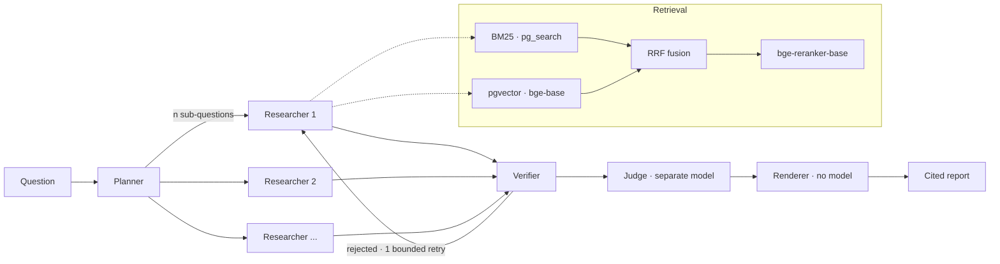

# AgentForge

A multi-agent research assistant that turns arXiv PDFs into citation-backed
reports, and the evaluation harness it was tuned with.

Every number below was produced by `make` targets in this repo and is
regenerated from SQL, not typed by hand.

```bash
cp .env.example .env     # no API key needed for anything below
make install && make db
make ingest-scifact      # BEIR SciFact, ~5k abstracts
make eval-retrieval      # the first table below. no key, no cost
```

---

## Results

### Retrieval ablation: BEIR SciFact, 300 queries, no LLM in the loop

Retrieval metrics are computed from ranks against gold qrels, so this table
costs nothing and can be re-run without limit. That is *why* every parameter
here was tuned rather than chosen.

| Arm | recall@10 | nDCG@10 | MRR | knob changed | paired Δ nDCG@10 (95% CI) |
|---|---|---|---|---|---|
| BM25 only (`pg_search`) | 0.8127 | 0.6843 | 0.6519 | baseline | n/a |
| Dense only (`bge-base`, HNSW) | 0.8676 | **0.7400** | **0.7079** | `retriever` | **+0.0556** [+0.0227, +0.0880] |
| Hybrid (RRF) | **0.8877** | 0.7389 | 0.7008 | `retriever` | −0.0011 [−0.0223, +0.0202] *ns* |
| + MiniLM rerank (MS MARCO) | 0.8272 | 0.6952 | 0.6665 | `rerank_model` | **−0.0436** [−0.0716, −0.0157] |
| + `bge-reranker-base` | 0.8488 | 0.7220 | 0.6927 | `rerank_model` | +0.0268 [−0.0006, +0.0546] *ns* |

Each row differs from the row above by **exactly one** knob, because a delta
across two simultaneous changes cannot be attributed to either:
`config.assert_comparable` refuses to tabulate such a comparison. Deltas are
paired-bootstrap over the same 300 questions; `ns` marks an interval containing
zero.

**Three findings, two of them negative:**

1. **Dense beats BM25 by +5.6 nDCG@10.** Expected.
2. **Hybrid RRF buys recall, not ordering.** recall@10 rises to 0.8877, best of
   any arm and +7.5 over BM25, while nDCG@10 is indistinguishable from dense
   alone. Fusion changes *which* documents are found, not the order they come
   back in. The two metrics disagreeing is the reason both are reported.
3. **Cross-encoder reranking degrades a strong hybrid first stage here.** The MS
   MARCO MiniLM loses 4.4 nDCG points significantly; a BEIR-appropriate reranker
   recovers most of that but still loses recall@10 significantly against no
   reranking. So this is not "the wrong reranker was picked". Rather, a
   cross-encoder trained on other data reorders a good `bge-base` ranking for
   the worse *on SciFact*.

> On SciFact alone, reranking would ship off. On the arXiv tier below it wins by
> 18 nDCG points, so it ships on, with both measurements cited at the config
> field. A résumé bullet would have been right for the wrong reason. Carrying
> SciFact's verdict over would have shipped the product 18 points worse. The
> sign of a retrieval component's effect depended on the domain, and only
> measuring on the served corpus found that out.

### Retrieval on the project's own corpus: 300 arXiv papers, 27,303 chunks

`make eval-retrieval CORPUS=arxiv-rag TIER=arxiv40`. Scored against span-level
gold: the chunks that state each of the 40 questions' answers.

| Arm | recall@10 | nDCG@10 | MRR | knob changed | paired Δ nDCG@10 (95% CI) |
|---|---|---|---|---|---|
| BM25 only (`pg_search`) | 0.6441 | 0.5027 | 0.5724 | baseline | n/a |
| Dense only (`bge-base`, HNSW) | 0.5404 | 0.4156 | 0.4938 | `retriever` | −0.0871 [−0.2270, +0.0488] *ns* |
| Hybrid (RRF) | 0.6648 | 0.5017 | 0.5556 | `retriever` | **+0.0861** [+0.0206, +0.1511] |
| + MiniLM rerank (MS MARCO) | 0.6864 | 0.5809 | 0.7001 | `rerank_model` | +0.0792 [−0.0053, +0.1687] *ns* |
| + `bge-reranker-base` | **0.7497** | **0.6824** | **0.8027** | `rerank_model` | **+0.1015** [+0.0385, +0.1746] |

Against plain hybrid directly, `bge-reranker-base` gains **+0.181 nDCG@10
[+0.103, +0.261]** and **+0.085 recall@10 [+0.024, +0.158]**, so it is the
shipped default.

- **BM25 beats dense here**, the reverse of SciFact. Many of these questions
  hinge on exact numbers and named methods, which favour lexical matching. The
  questions were also drafted from their gold chunks, which favours BM25 (see
  limitations). The two biases cannot be separated at n=40.
- **The interval width is the point of the SciFact tier.** At n=40, dense vs
  BM25 spans 27 points and is not significant. The reranker effect clears it
  only because it is large.

### PDF parser, measured against arXiv's own LaTeXML rendering

Heading detection is a font-geometry heuristic, so the only honest answer to
"how often is it wrong?" is a number. Ground truth is `arxiv.org/html/<id>`,
rendered from the authors' LaTeX, with no labelling and, no cost. `make measure-parser`.
All 300 papers, 287 of which have a LaTeXML rendering to score against.

| Metric | Mean | What it bounds |
|---|---|---|
| **Text coverage** | **0.981** | The one that matters: 98.1% of extracted characters land inside a section, so almost nothing is unchunked and unretrievable. 11% of papers fall below 0.95; the worst is 0.859. |
| Section recall | 0.328 | A third of the authors' block-level headings are detected (median 0.273; 73 papers below 0.2, 20 at 0.75 or above). |
| Section precision | 0.814 | 81% of detected headings are real (median 0.857). |

**These fail differently and must not be conflated.** A missed heading does not
lose text: the body merges into the preceding section, so every character is
still chunked, embedded and citable; what degrades is how precisely a citation
can name *which* section it came from. Uncovered text is the failure that would
actually invalidate a retrieval number, and it sits at 1.9% (mostly title,
authors and affiliations, which precede the first heading by design).

Recall varies widely by paper (interquartile range 0.19–0.40). The per-paper
rows are in [`results/parser-fidelity.md`](results/parser-fidelity.md).
Run-in `\paragraph{}`
labels are counted but **not scored**. They render inline with their prose, so
a line-based parser cannot see them, and on one paper they are 25 of 38 LaTeXML
headings. Scoring against them reported 0.158 for that paper, which described
the metric's definition rather than the parser's quality.

### End-to-end: 40 arXiv questions, frozen before building

The set is [`data/arxiv40.jsonl`](data/arxiv40.jsonl): 32 single-paper and 8
two-paper questions over a seeded random sample of 40 papers. They were drafted
by Claude from the chunks themselves, never from retrieval output, so gold is
not biased toward any arm. Gold is every chunk in the paper that states the
answer, found by a whole-paper search. `make load-questions` refuses to change a question once any
run exists on the tier.

`make eval-e2e ARM=…` then `make report-e2e`. Generator and judge are
`claude-haiku-5-5` at effort `low`, retrieval is the shipped hybrid +
`bge-reranker-base`, and the whole table cost **$0.26 at list price**.

| Arm | correctness | groundedness | fabricated quotes | unsupported (of real quotes) | gold chunk cited | tokens/q |
|---|---|---|---|---|---|---|
| No-retrieval control | 0.067 | n/a | n/a | n/a | n/a | 502 |
| Single agent | 0.829 | 0.535 | 1.8% | 45.5% | 0.925 | 6,684 |
| Four-role graph | **0.873** | **0.630** | **0.0%** | 37.0% | **0.975** | 20,466 |
| Four-role graph, no retry | 0.873 | 0.614 | 3.3% | 36.6% | 0.975 | 18,175 |

Correctness is deterministic key-fact recall against each question's
`answer_keys`, with no judge involved. Groundedness is the share of citations
whose quote is verbatim in the cited chunk *and* judged to entail its claim.
Paired bootstrap, n=40:

| Comparison | Δ correctness (95% CI) | Δ groundedness (95% CI) |
|---|---|---|
| control → single agent | **+0.763** [+0.638, +0.875] | n/a |
| single agent → four-role graph | +0.044 [−0.050, +0.148] *ns* | +0.076 [−0.019, +0.173] *ns* |
| graph without retry → with retry | +0.000 *ns* | +0.013 [−0.003, +0.030] *ns* |

**Three findings, two of them negative:**

1. **Retrieval is the whole gain.** Without it the model answers 6.7% of key
   facts. Every credited control answer begins "I don't know" and earns its keys
   from generic phrasing, so this is a scoring floor, not contamination.
2. **The four-role graph is not measurably better than one agent at n=40,** and
   it costs 3× the tokens. Every number points its way: correctness +4.4,
   groundedness +7.6, fabricated quotes 1.8% → 0, gold chunk cited 0.925 →
   0.975. But neither headline interval excludes zero. "Multi-agent improves
   grounding" is a hypothesis this set cannot confirm; it needs more questions.
3. **The bounded retry fixes fabrication, not answers.** It fired on 8 of 40
   questions and took fabricated quotes from 14 to 0, at +13% tokens.
   Correctness did not move on any question. It also shows the deterministic
   half of the metric doing its job: a non-verbatim quote is caught by `str.find`, sent back once,
   and repaired.

The weak spot is the fuzzy half. Even in the best arm, 37% of real quotes do not
entail their claim. Real quotes attached to over-reaching claims are the
dominant failure, and they are what the judge exists to catch.

### The judge, validated

`make validate-judge` scores candidate judges over 100 reference pairs
([`data/judge_reference.jsonl`](data/judge_reference.jsonl)) and ships the
cheapest one clearing κ ≥ 0.70. An unvalidated LLM judge makes every
groundedness number above it decorative.

| Judge | κ | agreement | n | labels |
|---|---|---|---|---|
| `claude-haiku-5-5` | **0.969** | 0.980 | 100 | Claude-drafted, quotes verified verbatim |

Both disagreements go in the conservative direction: the judge called one
*entailed* pair *contradicted* and one *contradicted* pair *unsupported*. It
never accepted an unsupported claim, so it does not inflate groundedness. The
labels deliberately include the hard case the judge prompt warns about: a quote
on the right topic that does not establish the claim.

The judge is the same model as the generator. The budget was Claude-only on the
cheapest model, and a stronger Claude judge would have cost most of it. The
separation that remains is context: the judge sees one claim and one quote,
never the question or the generator's reasoning. The reference labels were also
drafted by a Claude model, with every quote verified verbatim against its
chunk, so κ measures agreement within one model family (see limitations).

κ rather than raw agreement, because the label distribution is skewed: in a
working system most claims are entailed, so a judge answering "entailed" every
time posts ~90% agreement with no skill at all. A test pins exactly that case.

---

## How it works



Three properties are the design, and each is pinned by a test rather than
asserted here:

**Researchers are context-isolated.** Each holds only its own sub-question's
evidence. A single agent accumulates every chunk from every sub-question into
one window and dilutes its own attention. That is the measurable argument for more than
one agent, and why a **single-agent arm ships alongside as the baseline**.
Without that baseline, "why multi-agent?" is a question of taste; with it, it is
a table.

**The Verifier never sees the Synthesizer's reasoning**, only a claim and the
span it cites. A verifier sharing context with the writer rubber-stamps its own
prior reasoning, which turns evidence verification from a check into decoration.

**Claims are structure, not prose.** The Synthesizer emits
`{claim, citations: [{chunk_id, verbatim_quote}]}` and the report is rendered
from it. Two payoffs: no post-hoc decomposer whose error rate would leak into
every hallucination number (and partly into the judge's κ); and fabrication
detection becomes `str.find` against the cited chunk, with zero cost, zero variance and
no model involved. That splits the metric into a deterministic half (fabricated
quote, should be ~0) and a fuzzy half (the quote does not entail the claim),
which is the only half needing a judge.

The verify edge is **bounded at one retry**. Unbounded self-correction is how
these graphs become unpredictable in cost and unmeasurable in latency, and
whether the retry rescues claims or merely burns tokens is itself an arm.

## What "citation-backed" means here

A citation resolves to a *span*, not a filename. Every chunk carries
`(doc_id, page, char_start, char_end, bbox)`, so a claim points at a
highlightable rectangle on a page. Chunks are ~256 tokens because **the chunk is
the citation unit**; the generator is handed the expanded parent section
instead, so precision and context do not trade off.

Claims whose quote cannot be found, or that the judge finds unsupported, are
**rendered as explicitly unverified** rather than dropped. Dropping them would
hide the exact failure this project exists to count, and would silently inflate
its own groundedness numbers.

## Stack

| | |
|---|---|
| Orchestration | LangGraph-style fixed DAG, tool calling, bounded verify edge |
| Lexical | **real Okapi BM25** via ParadeDB `pg_search` 0.26 (Tantivy), not `ts_rank` |
| Dense | pgvector 0.8 HNSW, `bge-base-en-v1.5`, local, on MPS |
| Fusion | Reciprocal Rank Fusion (rank-based, so scale-free) |
| Generation | `claude-haiku-5-5`, effort `low`, structured outputs, content-addressed cache |
| Judge | `claude-haiku-5-5`, sees one claim and one quote only, validated by κ |
| Eval | own Postgres tables; config-hashed runs; paired bootstrap; Cohen's κ |
| Tracing | Langfuse Cloud (per-stage spans = the latency decomposition) |
| Serving | FastAPI, job-based; Docker Compose, two services |

One datastore on purpose: BM25 and vectors in the same Postgres means no
dual-write path and no window where a chunk is lexically searchable but not
semantically. The threshold at which that stops being true is single-digit
millions of chunks, not 27 thousand.

## Running it

```bash
cp .env.example .env
make install                 # local models: ~530 MB, fetched on first use
make db                      # ParadeDB: pg_search + pgvector, one container

# No API key, no cost:
make ingest-scifact          # BEIR SciFact tier
make index                   # BM25 + dense
make eval-retrieval          # the ablation table
make measure-parser          # parser fidelity
make test                    # integration-level, against a derived <db>_test database

# Requires ANTHROPIC_API_KEY:
make load-questions          # the frozen 40-question set
make load-judge-reference    # 100 reference pairs, quotes verified verbatim
make validate-judge          # κ table
make eval-e2e ARM=control    # then ARM=single, ARM=graph; resumable
make report-e2e              # the end-to-end table
make serve                   # http://localhost:8000/docs
```

`make db` uses `docker-compose`, not `docker compose`: Homebrew's compose
formula installs the plugin but the docker CLI only finds it when
`~/.docker/config.json` lists
`"cliPluginsExtraDirs": ["/opt/homebrew/lib/docker/cli-plugins"]`.

CI runs the retrieval tier on every push. It needs no credentials and costs
nothing, which is what makes it a real quality gate rather than a lint job.

## Honest limitations

- **Reranking's sign depends on the domain.** It lost on SciFact with both models
  tried, and won by 18 nDCG points on arXiv. It ships on, measured at n=40,
  which is enough for an effect this size but not for small ones.
- **The parser detects about a third of the authors' section headings** (recall
  0.328 over 287 papers). Text coverage stays at 0.981, so this costs citation granularity rather than
  retrievability.
- **An earlier version of the parser figure was a 6-paper sample.** It reported
  recall 0.497, and the full corpus says 0.328. Six papers was too few to quote
  as a property of the parser.
- **An earlier version of the retrieval table was wrong.** The first run scored
  `recall@10` on arms configured with `final_k=8`, structurally capping every arm
  at `recall@8`. The harness now refuses to score deeper than a run's `final_k`.
  The corrected numbers still show reranking losing, by slightly less.
- **The fidelity scorer was wrong three times before the parser was**. See the
  postscript in [docs/DESIGN.md](docs/DESIGN.md).
- **Questions and judge labels are model-drafted.** Both were drafted by Claude
  and machine-checked (gold chunks by whole-paper search, quotes verbatim), not
  hand-annotated. So κ is agreement within the Claude family, not with a human.
  The question set was frozen before any arm ran. Freezing removes
  tuning-to-the-test but not bias in which questions got asked, and a drafting
  error now stays in. Drafting from the gold chunk also tends to share its
  vocabulary, which favours BM25. Questions were paraphrased against that, but
  not measured. The SciFact tier exists partly as an independent check.
- **No end-to-end latency is reported.** The runs go through the cache, so a
  replayed call's wall-clock is SQL, not model time. Measuring latency needs a
  `cache_bypass` run, which re-bills every call. Retrieval-stage timings are
  unaffected and are in the run rows.
- **The judge errs strict, so groundedness is conservative.** It has called a
  correct claim about the Vietnamese dense-vs-hybrid result *contradicted*, once
  in validation and once in a live report. Claims quoting bare table numbers
  tend to come back *unsupported*. Both are observations, not a measured rate.
- **The four-role graph's advantage is unconfirmed.** Every metric favours it
  over the single agent, but at n=40 no interval excludes zero, and it costs 3×
  the tokens.

## Design decisions

Fourteen decisions with their reasoning and rejected alternatives, plus a
postscript recording every place the measurements contradicted the design:
**[docs/DESIGN.md](docs/DESIGN.md)**.
