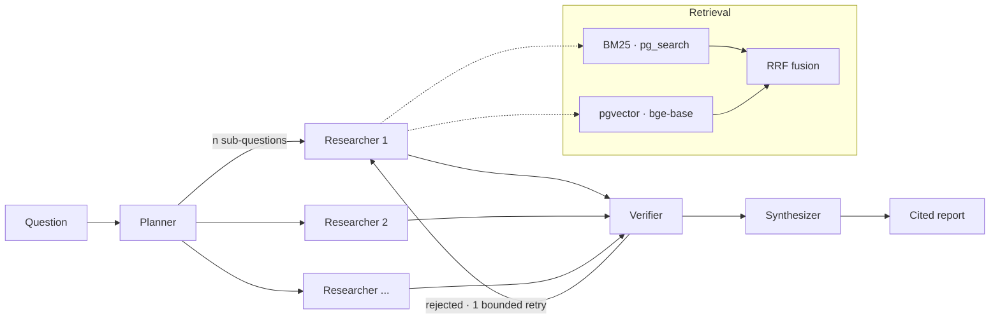

# AgentForge

A multi-agent research assistant that turns PDFs and web sources into
citation-backed reports — and the evaluation harness it was tuned with.

Every number below was produced by `make` targets in this repo and is
regenerated from SQL, not typed by hand. Blanks marked `[Mn]` are filled by that
milestone and are left visible on purpose, so you can see what has and has not
been measured.

```bash
cp .env.example .env     # no API key needed for anything below
make install && make db
make ingest-scifact      # BEIR SciFact, ~5k abstracts
make eval-retrieval      # the first table below. no key, no cost
```

---

## Results

### Retrieval ablation — BEIR SciFact, 300 queries, no LLM in the loop

Retrieval metrics are computed from ranks against gold qrels, so this table
costs nothing and can be re-run without limit. That is *why* every parameter
here was tuned rather than chosen.

| Arm | recall@10 | nDCG@10 | MRR | knob changed | paired Δ nDCG@10 (95% CI) |
|---|---|---|---|---|---|
| BM25 only (`pg_search`) | 0.8127 | 0.6843 | 0.6519 | — baseline | — |
| Dense only (`bge-base`, HNSW) | 0.8676 | **0.7400** | **0.7079** | `retriever` | **+0.0556** [+0.0227, +0.0880] |
| Hybrid (RRF) | **0.8877** | 0.7389 | 0.7008 | `retriever` | −0.0011 [−0.0223, +0.0202] *ns* |
| + MiniLM rerank (MS MARCO) | 0.8272 | 0.6952 | 0.6665 | `rerank_model` | **−0.0436** [−0.0716, −0.0157] |
| + `bge-reranker-base` | 0.8488 | 0.7220 | 0.6927 | `rerank_model` | +0.0268 [−0.0006, +0.0546] *ns* |

Each row differs from the row above by **exactly one** knob, because a delta
across two simultaneous changes cannot be attributed to either —
`config.assert_comparable` refuses to tabulate such a comparison. Deltas are
paired-bootstrap over the same 300 questions; `ns` marks an interval containing
zero.

**Three findings, two of them negative:**

1. **Dense beats BM25 by +5.6 nDCG@10.** Expected.
2. **Hybrid RRF buys recall, not ordering.** recall@10 rises to 0.8877 — best of
   any arm, +7.5 over BM25 — while nDCG@10 is indistinguishable from dense
   alone. Fusion changes *which* documents are found, not the order they come
   back in. The two metrics disagreeing is the reason both are reported.
3. **Cross-encoder reranking degrades a strong hybrid first stage here.** The MS
   MARCO MiniLM loses 4.4 nDCG points significantly; a BEIR-appropriate reranker
   recovers most of that but still loses recall@10 significantly against no
   reranking. So this is not "the wrong reranker was picked" — it is that a
   cross-encoder trained on other data reorders a good `bge-base` ranking for
   the worse. **Reranking therefore ships disabled**, with the measurement cited
   at the config field.

> Had this been built in résumé-bullet order, reranking would have shipped on by
> default and the claim "improved retrieval with cross-encoder reranking" would
> have been false by four points. That is the argument for building the harness
> before the features.

### Retrieval on the project's own corpus — 300 arXiv papers, 27,303 chunks

`[M2]` — regenerate with `make eval-retrieval CORPUS=arxiv-rag TIER=arxiv40`.
Reranking is re-measured here because the domain differs from SciFact.

### PDF parser, measured against arXiv's own LaTeXML rendering

Heading detection is a font-geometry heuristic, so the only honest answer to
"how often is it wrong?" is a number. Ground truth is `arxiv.org/html/<id>`,
rendered from the authors' LaTeX — no labelling, no cost. `make measure-parser`.
All 300 papers, 287 of which have a LaTeXML rendering to score against.

| Metric | Mean | What it bounds |
|---|---|---|
| **Text coverage** | **0.981** | The one that matters: 98.1% of extracted characters land inside a section, so almost nothing is unchunked and unretrievable. 11% of papers fall below 0.95; the worst is 0.859. |
| Section recall | 0.328 | A third of the authors' block-level headings are detected (median 0.273; 73 papers below 0.2, 20 at 0.75 or above). |
| Section precision | 0.814 | 81% of detected headings are real (median 0.857). |

**These fail differently and must not be conflated.** A missed heading does not
lose text — the body merges into the preceding section, so every character is
still chunked, embedded and citable; what degrades is how precisely a citation
can name *which* section it came from. Uncovered text is the failure that would
actually invalidate a retrieval number, and it sits at 1.9% (mostly title,
authors and affiliations, which precede the first heading by design).

Recall varies widely by paper (interquartile range 0.19–0.40). The per-paper
rows are in [`results/parser-fidelity.md`](results/parser-fidelity.md).
Run-in `\paragraph{}`
labels are counted but **not scored** — they render inline with their prose, so
a line-based parser cannot see them, and on one paper they are 25 of 38 LaTeXML
headings. Scoring against them reported 0.158 for that paper, which described
the metric's definition rather than the parser's quality.

### End-to-end — 40 arXiv questions, frozen before building

The set is [`data/arxiv40.jsonl`](data/arxiv40.jsonl): 32 single-paper and 8
two-paper questions over a seeded random sample of 40 papers. They were drafted
by Claude from the chunks themselves, never from retrieval output, so gold is
not biased toward any arm. Gold is every chunk in the paper that states the
answer, found by a whole-paper search. Each question is then reviewed and edited
by hand. `make load-questions` refuses to change a question once any run exists
on the tier.

`[M4]` · requires an API key. Arms: no-retrieval control, single agent, four-role
graph. The control is not filler — it quantifies how much the model already
knows cold, which is the only way to attribute any gain to retrieval rather than
to pretraining. The corpus is published **2026-09-16 → 2026-10-23**, after the
generator's training cutoff, so that attribution is clean by construction.

### The judge, validated

`[M4]` · `make validate-judge` scores `claude-haiku-4-5`, `claude-sonnet-5` and
`claude-opus-5` over the reference pairs and ships the cheapest clearing
κ ≥ 0.70 — chosen by measurement, not by price. An unvalidated LLM judge makes
every groundedness number above it decorative.

κ rather than raw agreement, because the label distribution is skewed: in a
working system most claims are entailed, so a judge answering "entailed" every
time posts ~90% agreement with no skill at all. A test pins exactly that case.

---

## How it works



Three properties are the design, and each is pinned by a test rather than
asserted here:

**Researchers are context-isolated.** Each holds only its own sub-question's
evidence. A single agent accumulates every chunk from every sub-question into
one window and dilutes its own attention — the measurable argument for more than
one agent, and why a **single-agent arm ships alongside as the baseline**.
Without that baseline, "why multi-agent?" is a question of taste; with it, it is
a table.

**The Verifier never sees the Synthesizer's reasoning** — only a claim and the
span it cites. A verifier sharing context with the writer rubber-stamps its own
prior reasoning, which turns evidence verification from a check into decoration.

**Claims are structure, not prose.** The Synthesizer emits
`{claim, citations: [{chunk_id, verbatim_quote}]}` and the report is rendered
from it. Two payoffs: no post-hoc decomposer whose error rate would leak into
every hallucination number (and partly into the judge's κ); and fabrication
detection becomes `str.find` against the cited chunk — zero cost, zero variance,
no model involved. That splits the metric into a deterministic half (fabricated
quote, should be ~0) and a fuzzy half (the quote does not entail the claim),
which is the only half needing a judge.

The verify edge is **bounded at one retry**. Unbounded self-correction is how
these graphs become unpredictable in cost and unmeasurable in latency — and
whether the retry rescues claims or merely burns tokens is itself an arm.

## What "citation-backed" means here

A citation resolves to a *span*, not a filename. Every chunk carries
`(doc_id, page, char_start, char_end, bbox)`, so a claim points at a
highlightable rectangle on a page. Chunks are ~256 tokens because **the chunk is
the citation unit**; the generator is handed the expanded parent section
instead, so precision and context do not trade off.

Claims whose quote cannot be found, or that the judge finds unsupported, are
**rendered as explicitly unverified** rather than dropped. Dropping them would
hide the exact failure this project exists to count — and would silently inflate
its own groundedness numbers.

## Stack

| | |
|---|---|
| Orchestration | LangGraph-style fixed DAG, tool calling, bounded verify edge |
| Lexical | **real Okapi BM25** via ParadeDB `pg_search` 0.26 (Tantivy) — not `ts_rank` |
| Dense | pgvector 0.8 HNSW, `bge-base-en-v1.5`, local, on MPS |
| Fusion | Reciprocal Rank Fusion (rank-based, so scale-free) |
| Generation | `claude-haiku-4-5`, structured outputs, content-addressed cache |
| Eval | own Postgres tables; config-hashed runs; paired bootstrap; Cohen's κ |
| Tracing | Langfuse Cloud (per-stage spans = the latency decomposition) |
| Serving | FastAPI, job-based; Docker Compose, two services |

One datastore on purpose: BM25 and vectors in the same Postgres means no
dual-write path and no window where a chunk is lexically searchable but not
semantically. The threshold at which that stops being true is single-digit
millions of chunks, not 27 thousand.

## Running it

```bash
cp .env.example .env
make install                 # local models: ~530 MB, fetched on first use
make db                      # ParadeDB: pg_search + pgvector, one container

# No API key, no cost:
make ingest-scifact          # BEIR SciFact tier
make index                   # BM25 + dense
make eval-retrieval          # the ablation table
make measure-parser          # parser fidelity
make test                    # 308 tests, integration-level against the live db

# Requires ANTHROPIC_API_KEY:
make validate-judge          # κ table
make serve                   # http://localhost:8000/docs
```

`make db` uses `docker-compose`, not `docker compose`: Homebrew's compose
formula installs the plugin but the docker CLI only finds it when
`~/.docker/config.json` lists
`"cliPluginsExtraDirs": ["/opt/homebrew/lib/docker/cli-plugins"]`.

CI runs the retrieval tier on every push. It needs no credentials and costs
nothing, which is what makes it a real quality gate rather than a lint job.

## No fallbacks

Every error raises. No `except: pass`, no degraded path, no defaults for absent
config, no partial ingests. A silent fallback corrupts attribution: a reranker
that quietly no-ops, or an ingest that drops the documents that failed to parse,
inflates the numbers above.

The rule needs one sharp edge to be workable, and it is in
[`src/agentforge/errors.py`](src/agentforge/errors.py):

- **A defect raises.** Schema-invalid model output, Postgres unreachable, a PDF
  that will not parse, a `chunk_id` absent from the index, missing config, a
  latency query against a cached run.
- **A model-quality outcome is data.** A fabricated quote, or a quote that does
  not entail its claim. These get a verdict row and ship flagged. Raising would
  mean the tool cannot report its own primary finding; dropping them would hide
  it.

## Honest limitations

- **Cross-encoder reranking lost to not reranking** on SciFact, with both models
  tried. It ships disabled, pending re-measurement on the arXiv tier.
- **The parser detects about a third of the authors' section headings** (recall
  0.328 over 287 papers). Text coverage stays at 0.981, so this costs citation granularity rather than
  retrievability.
- **An earlier version of the parser figure was a 6-paper sample.** It reported
  recall 0.497, and the full corpus says 0.328. Six papers was too few to quote
  as a property of the parser.
- **An earlier version of the retrieval table was wrong.** The first run scored
  `recall@10` on arms configured with `final_k=8`, structurally capping every arm
  at `recall@8`. The harness now refuses to score deeper than a run's `final_k`.
  The corrected numbers still show reranking losing, by slightly less.
- **The fidelity scorer was wrong three times before the parser was** — see the
  postscript in [docs/DESIGN.md](docs/DESIGN.md).
- **The 40-question set is model-drafted, then human-reviewed**, and frozen
  before any arm ran. Freezing removes tuning-to-the-test but not bias in which
  questions got asked. Drafting from the gold chunk also tends to share its
  vocabulary, which favours BM25. Questions were paraphrased against that, but
  not measured. The SciFact tier exists partly as an independent check.
- p95 latency is sequential single-request on an M3 MacBook Air, warm index,
  excluding ingestion. No concurrency testing — that is a different project.
- **Judge reference labels are `[M4]` model-generated and pending human review.**
  Until reviewed, κ measures model self-consistency, not human agreement, and is
  reported with that qualifier attached.

## Design decisions

Fifteen decisions with their reasoning and rejected alternatives — plus a
postscript recording every place the measurements contradicted the design:
**[docs/DESIGN.md](docs/DESIGN.md)**.
