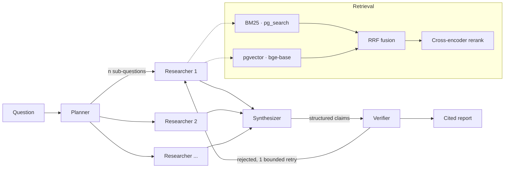

# AgentForge

A multi-agent research assistant that turns PDFs and web sources into
citation-backed reports — and the evaluation harness it was tuned with.

Every number below was produced by `make eval` on this machine and is regenerated
from SQL, not typed by hand. Blanks marked `[Mn]` are filled by that milestone;
they are deliberately visible so you can see what has and has not been measured
yet.

---

## Results

### Retrieval ablation — BEIR SciFact, 300 queries, no LLM in the loop

Retrieval metrics are computed from ranks against gold qrels, so this entire
table costs nothing to produce and can be re-run without limit. That is why
every parameter here was tuned rather than chosen.

Measured on an M3 MacBook Air: PostgreSQL 18.6, pg_search 0.26.3, pgvector
0.8.6, embeddings and reranking on MPS. Regenerate with `make report`.

| Arm | recall@10 | nDCG@10 | MRR | knob changed | paired Δ nDCG@10 (95% CI) |
|---|---|---|---|---|---|
| BM25 only (`pg_search`) | 0.8127 | 0.6843 | 0.6519 | — baseline | — |
| Dense only (`bge-base`, HNSW) | 0.8676 | **0.7400** | **0.7079** | `retriever` | **+0.0556** [+0.0227, +0.0880] |
| Hybrid (RRF) | **0.8877** | 0.7389 | 0.7008 | `retriever` | −0.0011 [−0.0223, +0.0202] *ns* |
| + MiniLM rerank (MS MARCO) | 0.8272 | 0.6952 | 0.6665 | `rerank_model` | **−0.0436** [−0.0716, −0.0157] |
| + `bge-reranker-base` | 0.8488 | 0.7220 | 0.6927 | `rerank_model` | +0.0268 [−0.0006, +0.0546] *ns* |

Each row differs from the row above by exactly **one** knob, because a delta
across two simultaneous changes cannot be attributed to either; the harness
refuses to tabulate such a comparison (`config.assert_comparable`). `ns` marks a
delta whose 95% paired-bootstrap interval includes zero — at n=300, reporting
those as wins would be the overclaim this project is built to avoid.

**Three findings, two of them negative:**

1. **Dense beats BM25 by +5.6 nDCG@10** (CI excludes zero). Expected.
2. **Hybrid RRF buys recall, not ordering.** recall@10 rises to 0.8877 — the best
   of any arm, +7.5 points over BM25 — while nDCG@10 is statistically
   indistinguishable from dense alone. RRF pulls more relevant documents into the
   top 10 without ranking them better. Those two metrics disagreeing is the
   whole reason both are reported.
3. **Cross-encoder reranking degrades a strong hybrid first stage here.** The MS
   MARCO MiniLM loses 4.4 nDCG points, significantly. Swapping in a
   BEIR-appropriate reranker recovers most of that (+2.7 vs MiniLM) but still
   loses recall@10 significantly against no reranking at all. So this is not
   "the wrong reranker was chosen" — it is that a 6-layer or base-size
   cross-encoder trained on other data reorders a good bge-base ranking for the
   worse. **Reranking therefore ships disabled by default**, and will be
   re-measured on the arXiv tier at M2, where the domain is different.

> This is why the eval tier was built before the agent graph. Had the pipeline
> been assembled in bullet order, reranking would have shipped on by default,
> the résumé would have claimed it as an improvement, and the claim would have
> been false by 4 points.

### End-to-end — 40 hand-written arXiv questions, frozen before the system was built

| Arm | groundedness | fabricated quotes | unsupported claims | p95 latency | $/query |
|---|---|---|---|---|---|
| No retrieval (control) | `[M4]` | `[M4]` | `[M4]` | `[M4]` | `[M4]` |
| Single agent + hybrid | `[M4]` | `[M4]` | `[M4]` | `[M4]` | `[M4]` |
| **Four-role graph** | `[M5]` | `[M5]` | `[M5]` | `[M5]` | `[M5]` |

The no-retrieval control is not filler: it quantifies how much the model already
knows cold, which is the only way to attribute any improvement to retrieval
rather than to pretraining.

### The judge, validated

| Judge model | κ vs reference labels | agreement | cost/run |
|---|---|---|---|
| `claude-haiku-4-5` | `[M4]` | `[M4]` | `[M4]` |
| `claude-sonnet-5` | `[M4]` | `[M4]` | `[M4]` |
| `claude-opus-5` | `[M4]` | `[M4]` | `[M4]` |

An unvalidated LLM judge makes every number above it decorative. The shipped
judge is the cheapest model clearing κ = 0.70 on 100 hand-labelled claim/evidence
pairs.

---

## How it works



Three properties worth naming, because they are the design:

**Researchers are context-isolated.** Each holds only its own sub-question's
evidence. A single agent accumulates every chunk from every sub-question into one
window and dilutes its own attention — which is the measurable argument for more
than one agent, and why a single-agent arm ships alongside as the baseline.

**The Verifier never sees the Synthesizer's reasoning** — only a claim and the
span it cites. A verifier sharing context with the writer rubber-stamps its own
prior reasoning.

**Claims are structure, not prose.** The Synthesizer emits
`{claim, citations: [{chunk_id, verbatim_quote}]}` and the report is rendered
from it. So fabrication detection is `str.find` against the cited chunk — zero
cost, zero variance, no model involved — and the fuzzy half (does the quote
*entail* the claim?) is the only part needing a judge.

---

## What "citation-backed" means here

A citation resolves to a span, not a filename. Every chunk carries
`(doc_id, page, char_start, char_end, bbox)`, so a claim points at a
highlightable rectangle on a page of a PDF. Chunks are ~256 tokens because the
chunk *is* the citation unit; the generator is handed the expanded parent section
instead, so precision and context do not have to trade off.

Claims whose quote cannot be found, or that the judge finds unsupported, are
**rendered in the report as explicitly unverified** rather than dropped. Dropping
them would hide the exact failure this project exists to count.

---

## Running it

```bash
cp .env.example .env            # ANTHROPIC_API_KEY only needed from M3 on
make install                    # local models: ~530 MB, downloaded on first use
make db                         # ParadeDB (pg_search + pgvector), waits for health
make ingest-scifact             # BEIR SciFact, ~5k abstracts
make eval-retrieval             # the table above. no API key, no cost
make report                     # regenerate the table from stored runs
```

`make db` shells out to `docker-compose`, not `docker compose`: Homebrew's
compose formula installs the CLI plugin but the docker CLI only finds it if
`~/.docker/config.json` lists `"cliPluginsExtraDirs": ["/opt/homebrew/lib/docker/cli-plugins"]`.
Both spellings work once that key is present.

`make eval-retrieval` needs no credentials and costs nothing, which is also why
CI can run it on every push.

---

## Honest limitations

- **Cross-encoder reranking lost to not reranking** on SciFact, with both models
  tried (see Results, finding 3). It ships disabled, pending re-measurement on
  the arXiv tier.
- **An earlier version of this table was wrong.** The first ablation run scored
  `recall@10` on arms configured with `final_k=8`, which structurally capped
  every arm at `recall@8` and made reranking look worse than it was. The harness
  now refuses to score at a cutoff deeper than the pipeline's `final_k`
  (`MeasurementError`), and the ladder runs at `final_k=20`. The corrected
  numbers still show reranking losing, but by less.
- `[M6]` — further negative results go here.
- The 40-question set was written by one person (me) and frozen before building.
  That removes tuning-to-the-test but not the bias in which questions got asked.
  The SciFact tier exists partly as an independent check on that.
- p95 latency is sequential single-request on an M3 MacBook Air, warm index,
  excluding ingestion. No concurrency testing.
- Judge reference labels are `[M4: model-generated, pending human review]`.
  Until reviewed, κ measures model self-consistency, not human agreement, and is
  labelled as such.

## Design decisions

Fifteen decisions with their reasoning and rejected alternatives:
**[docs/DESIGN.md](docs/DESIGN.md)**.
