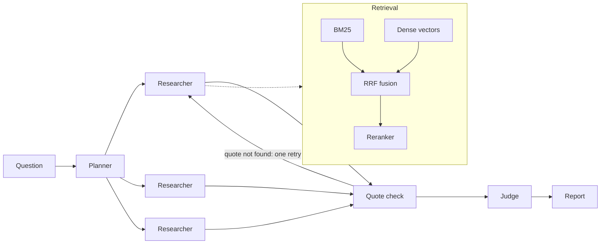

# AgentForge

AgentForge answers research questions from a collection of 300 arXiv papers on
retrieval and RAG. Each sentence in its report cites a passage copied word for
word from a paper, and each citation is checked before the report is returned.
Citations that fail the check stay in the report, marked as unverified.

The repo also contains the evaluation harness used to build it. Every number in
this README comes from a `make` target and is stored in `results/`.

## Example

Asked *"Why can a 95% conformal factuality target give a misleading picture for
GPT-4o-mini on multi-hop HotpotQA and NQ?"*, it returns (abridged):

> At the 95% conformal target, GPT-4o-mini on HotpotQA and NQ achieves overall
> full-support rates of 97.20% and 96.43% of responses. [^21]
>
> At the 95% conformal target, only 10.80% and 9.70% of GPT-4o-mini responses on
> HotpotQA and NQ remain non-empty. [^22]
>
> Because empty filtered responses satisfy the full-support event vacuously, high
> overall factuality can coexist with low non-empty response coverage. [^24]
>
> **Verification:** 16 of 24 citations verified against their sources; 8 unsupported
>
> [^22]: 2609.38222v1:28: "while only 10.80% and 9.70% of responses remain non-empty."

Each footnote names a chunk of a specific paper. The quote is confirmed to
appear in that chunk exactly, and a separate model call judges whether it
supports the sentence. This query cost about $0.003.

## Quick start

Needs Docker and Python 3.13. The first block needs no API key and costs
nothing.

```bash
cp .env.example .env
make install          # Python deps; local models (~530 MB) download on first use
make db               # Postgres with pg_search and pgvector, in Docker
make ingest-scifact   # BEIR SciFact, ~5k abstracts
make index
make eval-retrieval   # retrieval ablation on SciFact
make test
```

To run the assistant itself, put an `ANTHROPIC_API_KEY` in `.env`, then:

```bash
make ingest-arxiv     # download, parse and chunk the 300 papers
make index CORPUS=arxiv-rag
make serve            # API docs at http://localhost:8000/docs
```

```bash
curl -X POST localhost:8000/research -H 'content-type: application/json' \
  -d '{"question": "...", "arm": "four_role"}'      # returns a job_id
curl localhost:8000/research/<job_id>                 # poll until status is "done"
```

`arm` is `four_role` (default) or `single_agent`. `docker-compose up` runs the
API and database together, with both local models baked into the image.

## How it works



1. **Plan.** The planner splits the question into up to four sub-questions.
2. **Research.** One researcher per sub-question, running in parallel. Each
   retrieves its own evidence and answers in a fixed JSON shape: a list of
   claims, each with a `chunk_id` and a quote. Researchers don't see each
   other's evidence.
3. **Quote check.** Plain code checks that every quote appears in the chunk it
   cites. Claims with a missing quote go back to their researcher once, with the
   reason. There is only one retry, so cost and latency stay bounded.
4. **Judge.** A model call sees one claim and its quote, nothing else, and labels
   it entailed, contradicted or unsupported.
5. **Report.** The report is assembled from the claims by code, not a model, so
   no text is added after verification.

**Retrieval** is hybrid. BM25 (ParadeDB `pg_search`) and dense search
(`bge-base-en-v1.5` in pgvector) each return candidates. Reciprocal rank fusion
merges them, and `bge-reranker-base` reorders the top results. Papers are split
into ~256-token chunks for retrieval and citation, and the researcher reads the
surrounding section. Both indexes live in one Postgres database.

The **single-agent** arm makes one research call over the same retrieval, with no
planner and no retry, and runs the same checks. It exists to measure what the
extra roles add.

**Models:** `claude-haiku-5-5` for planning, research and judging. Embeddings and
reranking run locally. Model calls are cached by content hash, so re-running an
evaluation costs nothing.

## Results

### Answer quality (40 questions)

[`data/arxiv40.jsonl`](data/arxiv40.jsonl) holds 40 questions over a random
sample of the papers: 32 about one paper, 8 that need two. The set was fixed
before any configuration was run on it.

| Arm | Correctness | Groundedness | Fabricated quotes | Tokens per question |
|---|---|---|---|---|
| No retrieval (control) | 0.067 | n/a | n/a | 502 |
| Single agent | 0.829 | 0.535 | 1.8% | 6,684 |
| Four-role pipeline | **0.873** | **0.630** | **0.0%** | 20,466 |
| Four-role, no retry | 0.873 | 0.614 | 3.3% | 18,175 |

- *Correctness* is the share of each question's key facts the answer states,
  matched by string, with no model involved.
- *Groundedness* is the share of citations whose quote is real and that the
  judge says support their claim.

Retrieval accounts for almost all of the gain: +0.76 correctness over the
control (95% CI +0.64 to +0.88). The four-role pipeline scores higher than the
single agent on every metric, but at 40 questions neither difference is
statistically significant, and it uses three times the tokens. The retry fired
on 8 questions. It removed all 14 fabricated quotes and changed no answer's
correctness.

The main remaining failure is a real quote attached to a claim that goes beyond
it. Even in the best arm, 37% of real quotes don't fully support their claim.

The full evaluation cost $0.26. Per-arm detail and paired confidence intervals
are in [`results/e2e-arxiv40.md`](results/e2e-arxiv40.md).

### Retrieval

On the 300 arXiv papers (27,303 chunks), scored against the chunks that contain
each question's answer:

| Configuration | recall@10 | nDCG@10 |
|---|---|---|
| BM25 | 0.644 | 0.503 |
| Dense | 0.540 | 0.416 |
| Hybrid (RRF) | 0.665 | 0.502 |
| Hybrid + MiniLM reranker | 0.686 | 0.581 |
| Hybrid + `bge-reranker-base` | **0.750** | **0.682** |

Adding `bge-reranker-base` to hybrid improves nDCG@10 by 0.18 (95% CI 0.10 to
0.26), so it is the default.

The same comparison on BEIR SciFact (300 queries) came out the other way. There,
dense retrieval was best and both rerankers made results worse
([`results/retrieval-scifact.md`](results/retrieval-scifact.md)). Many arXiv
questions turn on exact numbers and method names, which suits BM25 and a
reranker. The questions were also written from the chunks that answer them,
which favours BM25, and 40 questions are too few to separate the two effects.

CI runs the retrieval benchmark on a 300-document slice on every push. It needs
no API key.

### Judge

The judge was scored against 100 claim and quote pairs with known labels
([`data/judge_reference.jsonl`](data/judge_reference.jsonl)). It agreed on 98 of
100 (Cohen's κ = 0.969). In both disagreements it was stricter than the label,
so it doesn't inflate groundedness.

### PDF parsing

Section headings are detected from font size and layout. Compared with arXiv's
own HTML rendering of 287 of the papers, 98.1% of extracted text lands in a
section. The parser finds 33% of the authors' headings, and 81% of the headings
it finds are real. A missed heading doesn't lose text: it merges into the
previous section, so citations name a less precise section. Per-paper numbers
are in [`results/parser-fidelity.md`](results/parser-fidelity.md).

## Limitations

- The 40 questions and the 100 judge labels were drafted by Claude and checked
  by script: answers located by searching the whole paper, quotes matched
  exactly. No person annotated them. The judge's κ is therefore agreement with
  another Claude model, not with a human.
- The generator and the judge are the same model, chosen to fit a small budget.
  The judge only ever sees one claim and one quote.
- Forty questions are enough to detect large effects like retrieval and
  reranking, but not the smaller gap between the single agent and the four-role
  pipeline.
- The judge leans strict. Claims citing bare table numbers often come back
  unsupported, so groundedness is likely understated.
- The assistant always answers. When no paper covers a question, it assembles
  loosely related facts instead of saying the papers don't address it.
- End-to-end latency isn't reported. The evaluation runs replay cached model
  calls, so their timings don't reflect real model time.

## Repository layout

```
src/agentforge/
  ingest/      PDF fetching, parsing, chunking, question loading
  retrieval/   BM25, dense search, fusion, reranking
  agents/      planner, researchers, quote check, judge, report rendering
  eval/        metrics, bootstrap intervals, judge validation, end-to-end runs
  api/         FastAPI service
data/          frozen questions and judge reference pairs
results/       generated result tables
docs/          DESIGN.md: design decisions and what the measurements changed
```
