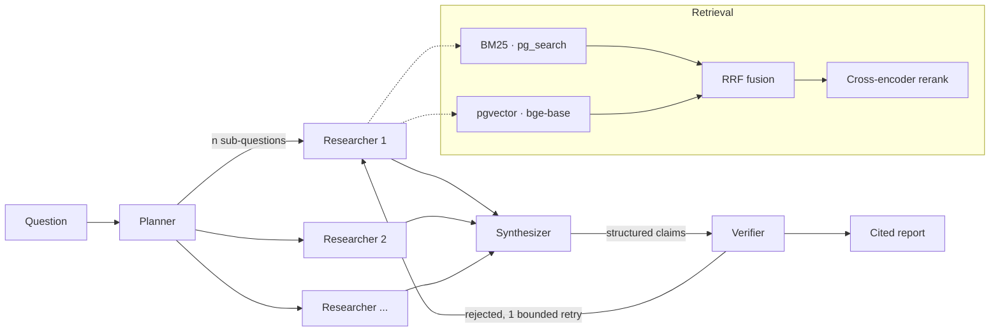

# AgentForge

A multi-agent research assistant that turns PDFs and web sources into
citation-backed reports — and the evaluation harness it was tuned with.

Every number below was produced by `make eval` on this machine and is regenerated
from SQL, not typed by hand. Blanks marked `[Mn]` are filled by that milestone;
they are deliberately visible so you can see what has and has not been measured
yet.

---

## Results

### Retrieval ablation — BEIR SciFact, 300 queries, no LLM in the loop

Retrieval metrics are computed from ranks against gold qrels, so this entire
table costs nothing to produce and can be re-run without limit. That is why
every parameter here was tuned rather than chosen.

| Arm | recall@10 | nDCG@10 | MRR | index time | p95 query |
|---|---|---|---|---|---|
| BM25 only (`pg_search`) | `[M1]` | `[M1]` | `[M1]` | `[M1]` | `[M1]` |
| Dense only (`bge-base`, pgvector HNSW) | `[M1]` | `[M1]` | `[M1]` | `[M1]` | `[M1]` |
| Hybrid (RRF) | `[M1]` | `[M1]` | `[M1]` | `[M1]` | `[M1]` |
| **Hybrid + cross-encoder rerank** | `[M1]` | `[M1]` | `[M1]` | `[M1]` | `[M1]` |

Each row differs from the one above it by exactly **one** knob, because a delta
across two simultaneous changes cannot be attributed to either; the harness
refuses to tabulate such a comparison (`config.assert_comparable`). Reported
with a paired bootstrap CI, since at these sample sizes a point estimate alone
would invite an overclaim.

Swept as single-knob arms: chunk size (256/512/1024), contextual prefix on/off,
embedding model (`bge-small` / `bge-base` / `bge-m3`), reranker
(`MiniLM-L-6` / `bge-reranker-base`), BM25 analyzer (stemming, stopwords), RRF `k`.

> BM25 `k1`/`b` are **not** swept: `pg_search` 0.26.3 does not expose them
> (Tantivy fixes 1.2/0.75), so the config has no field for them. The analyzer is
> what is tunable here.

### End-to-end — 40 hand-written arXiv questions, frozen before the system was built

| Arm | groundedness | fabricated quotes | unsupported claims | p95 latency | $/query |
|---|---|---|---|---|---|
| No retrieval (control) | `[M4]` | `[M4]` | `[M4]` | `[M4]` | `[M4]` |
| Single agent + hybrid | `[M4]` | `[M4]` | `[M4]` | `[M4]` | `[M4]` |
| **Four-role graph** | `[M5]` | `[M5]` | `[M5]` | `[M5]` | `[M5]` |

The no-retrieval control is not filler: it quantifies how much the model already
knows cold, which is the only way to attribute any improvement to retrieval
rather than to pretraining.

### The judge, validated

| Judge model | κ vs reference labels | agreement | cost/run |
|---|---|---|---|
| `claude-haiku-4-5` | `[M4]` | `[M4]` | `[M4]` |
| `claude-sonnet-5` | `[M4]` | `[M4]` | `[M4]` |
| `claude-opus-5` | `[M4]` | `[M4]` | `[M4]` |

An unvalidated LLM judge makes every number above it decorative. The shipped
judge is the cheapest model clearing κ = 0.70 on 100 hand-labelled claim/evidence
pairs.

---

## How it works



Three properties worth naming, because they are the design:

**Researchers are context-isolated.** Each holds only its own sub-question's
evidence. A single agent accumulates every chunk from every sub-question into one
window and dilutes its own attention — which is the measurable argument for more
than one agent, and why a single-agent arm ships alongside as the baseline.

**The Verifier never sees the Synthesizer's reasoning** — only a claim and the
span it cites. A verifier sharing context with the writer rubber-stamps its own
prior reasoning.

**Claims are structure, not prose.** The Synthesizer emits
`{claim, citations: [{chunk_id, verbatim_quote}]}` and the report is rendered
from it. So fabrication detection is `str.find` against the cited chunk — zero
cost, zero variance, no model involved — and the fuzzy half (does the quote
*entail* the claim?) is the only part needing a judge.

---

## What "citation-backed" means here

A citation resolves to a span, not a filename. Every chunk carries
`(doc_id, page, char_start, char_end, bbox)`, so a claim points at a
highlightable rectangle on a page of a PDF. Chunks are ~256 tokens because the
chunk *is* the citation unit; the generator is handed the expanded parent section
instead, so precision and context do not have to trade off.

Claims whose quote cannot be found, or that the judge finds unsupported, are
**rendered in the report as explicitly unverified** rather than dropped. Dropping
them would hide the exact failure this project exists to count.

---

## Running it

```bash
cp .env.example .env            # ANTHROPIC_API_KEY only needed from M3 on
docker compose up -d db         # ParadeDB: pg_search + pgvector, one container
make install                    # local models: ~530 MB total
make ingest-scifact             # BEIR SciFact, ~5k abstracts
make eval-retrieval             # the first table above. no API key, no cost
```

`make eval-retrieval` needs no credentials and costs nothing, which is also why
CI can run it on every push.

---

## Honest limitations

- `[M6]` — negative results and things that did not work go here, including any
  arm where the sophisticated option lost to the simple one.
- The 40-question set was written by one person (me) and frozen before building.
  That removes tuning-to-the-test but not the bias in which questions got asked.
  The SciFact tier exists partly as an independent check on that.
- p95 latency is sequential single-request on an M3 MacBook Air, warm index,
  excluding ingestion. No concurrency testing.
- Judge reference labels are `[M4: model-generated, pending human review]`.
  Until reviewed, κ measures model self-consistency, not human agreement, and is
  labelled as such.

## Design decisions

Fifteen decisions with their reasoning and rejected alternatives:
**[docs/DESIGN.md](docs/DESIGN.md)**.
